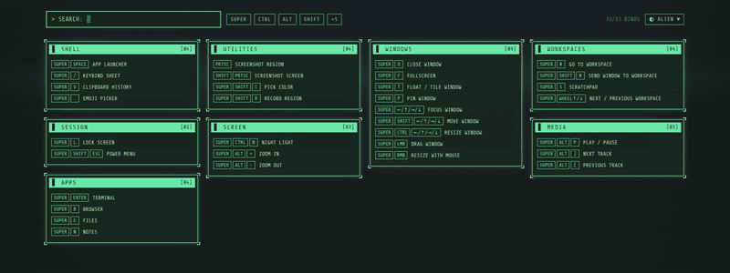
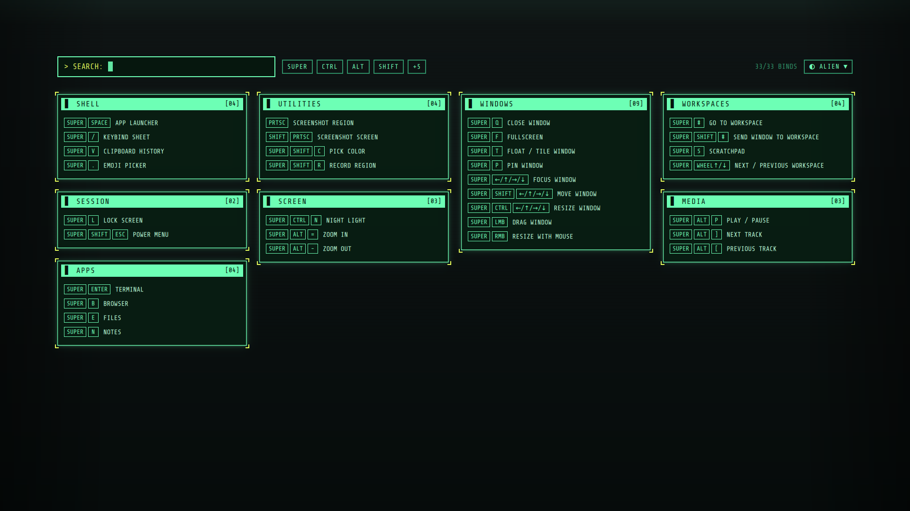
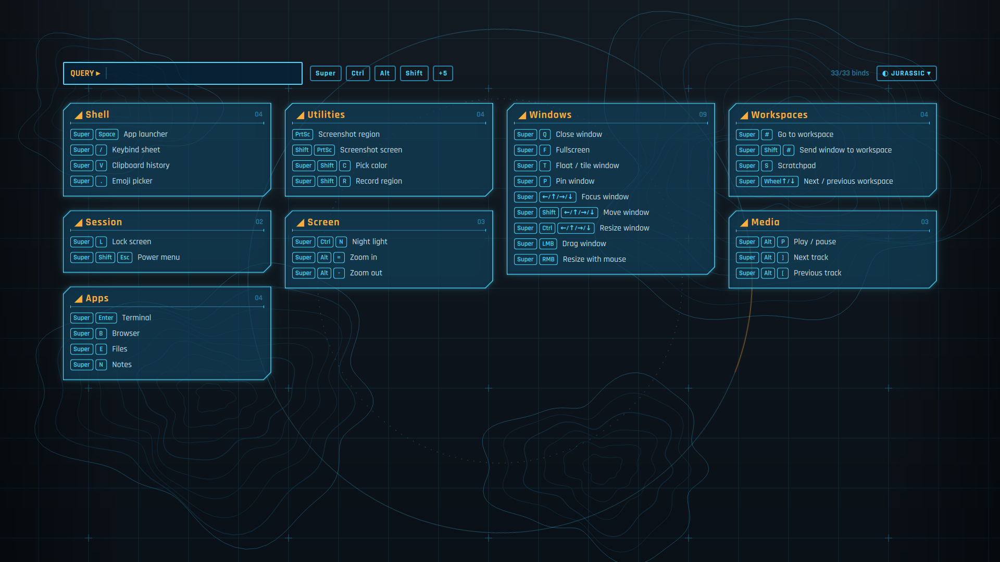
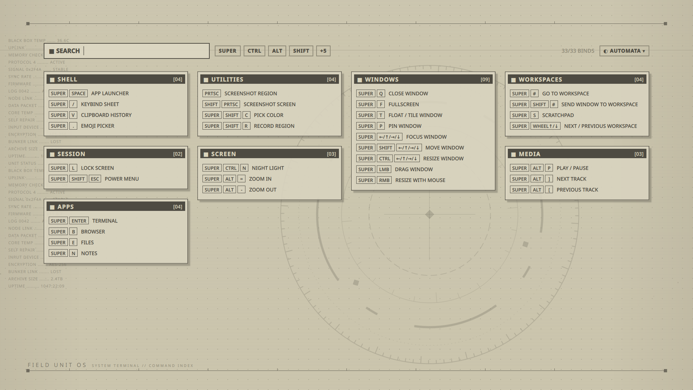

# keyhud

A searchable overlay of your Hyprland keybinds, drawn like a computer
screen out of a film or a game. It runs as its own
[Quickshell](https://quickshell.org) config, so it works next to whatever
bar or shell you already use.



I kept forgetting my own binds, and every cheat sheet I tried was a list I
had to keep in sync by hand. This one reads your binds straight from
`hyprctl -j binds` every time it opens: change a bind in your config,
reload, and the sheet already shows it.

Three looks so far:

| alien | jurassic | automata |
| --- | --- | --- |
|  |  |  |

- **alien**: green-phosphor CRT terminal with scanlines
- **jurassic**: holographic map table with contour lines that drift with
  the mouse
- **automata**: dark ink on beige paper, with hard offset shadows

## Requirements

- Hyprland
- Quickshell (tested with 0.3)
- Optional fonts: Share Tech Mono (alien), Rajdhani (jurassic), Noto Sans
  (automata). Without them Qt falls back to a default font.

## Install

```sh
git clone https://github.com/Coimbrice/keyhud ~/.config/quickshell/keyhud
```

Start it with Hyprland and bind a key to open it. In `hyprland.conf`:

```ini
exec-once = qs -c keyhud
bind = SUPER, slash, exec, qs -c keyhud ipc call keyhud toggle
```

Or, with the Lua config:

```lua
hl.on("hyprland.start", function()
    hl.exec_cmd("qs -c keyhud")
end)
hl.bind("SUPER + slash", hl.dsp.exec_cmd("qs -c keyhud ipc call keyhud toggle"))
```

Type to filter, click Super / Ctrl / Alt / Shift to only see binds that use
those modifiers, and press Esc to clear the search and then close.

## Naming your binds

keyhud groups binds into panels (Shell, Utilities, Windows, Workspaces,
Session, Screen, Media, Apps). The best way to control what each row says
is a bind description in the form `Group: sentence`:

```ini
bindd = SUPER, Q, Windows: Close window, killactive,
bindd = SUPER, RETURN, Apps: Terminal, exec, kitty
bindd = SUPER, C, Windows (more): Close window, killactive,
```

```lua
hl.bind("SUPER + Q", hl.dsp.window.close(), { description = "Windows: Close window" })
```

- The group word is always in English (`Shell`, `Utilities`, `Windows`,
  `Workspaces`, `Session`, `Screen`, `Media`, `Apps`). The sentence after
  the colon can be in any language.
- `(more)` hides the row until you click the `+N` chip. That's useful for
  second keys that do the same thing.
- Binds with the same group, modifiers and sentence fold into one row:
  four arrow keys become `←/↑/→/↓`, the number row becomes `#`.

With the Lua config this is required, because Hyprland doesn't tell
`hyprctl` what a Lua bind runs. With `hyprland.conf`, binds without a
description still show up: keyhud guesses a sentence from the dispatcher
and command (`workspace, 1..5` becomes "Focus workspace # (1–5)", `exec,
firefox` becomes "Browser"), and leaves out hardware keys and binds it
can't name until you click `+N`.

## Configuration

Settings live in `~/.config/keyhud/config.json` and are reloaded as soon
as you save the file. All keys are optional:

```json
{
  "theme": "alien",
  "themePicker": true,
  "parallax": true,
  "language": "en"
}
```

- `theme`: `alien`, `jurassic` or `automata`.
- `themePicker`: shows the theme button in the header, with a dropdown
  that previews each theme as you move over it (also `Ctrl+T`, then Up /
  Down and Enter). The theme picked there is remembered and wins over
  `theme`. Set it to `false` to hide the button and use `theme` only.
- `parallax`: themes that support it (jurassic, for now) drift the
  backdrop slightly against the mouse pointer. Set it to `false` to keep
  the backdrop still.
- `language`: `en` or `pt`. This only covers keyhud's own text (search
  label, panel titles, counters). Bind names are whatever your
  descriptions say.

The other commands it takes:

```sh
qs -c keyhud ipc call keyhud toggle
qs -c keyhud ipc call keyhud hide
qs -c keyhud ipc call keyhud setTheme automata
qs -c keyhud ipc call keyhud themes
```

## Adding a theme

A theme is one entry in `lib/themes.js`: colors, fonts and a few switches
(title strip, corner brackets, glow or offset shadow, backdrop effects).
Add its name to `ORDER` and it appears in the picker. The tests check that
every theme has the same keys as the others.

## Development

```sh
make test   # parser, themes and strings, with Node's test runner
make lint   # qmllint over the QML files
```

To try changes, symlink the clone into `~/.config/quickshell/keyhud` and
run `qs -c keyhud` in a terminal to see its log.

`KEYHUD_DEMO=1 qs -c keyhud` shows the sample binds in `demo/binds.json`
on a plain background instead of your own binds and desktop. The
screenshots above were taken that way.

## Credits

Based on the code of the keybind cheat sheet in
[SekaiPop](https://github.com/Blapples/SekaiPop) by Blapples. The panel
grouping follows the one in end-4's
[Illogical Impulse](https://github.com/end-4/dots-hyprland).

I built keyhud with help from Claude, which helped with the code, the
review and the organization of the repo.

## License

GPL-3.0, like SekaiPop. See [LICENSE](LICENSE).
